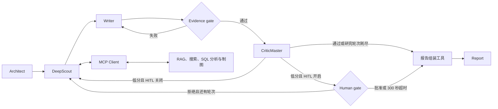

# DeepResearch 执行与演示接口

## 执行路径

`POST /query` 的入口 Router 选择 `general` 或 `multiagent`。分类不确定时进入研究。General 直接回答。研究图内的 Router 只分类领域意图，不会将已经选定的研究任务改为 General。

研究主链如下。



研究的初始轮次为 0，最多再补研两轮。自动补研与人工拒绝共用这个预算。事实关卡有独立的两次重写预算，每轮补研重新计算。重写耗尽仍未通过时，返回 HTTP 422，不进入 Critic，不启动 ReAct。空证据仍执行校验，可以输出说明证据不足的定性内容。

模型、工具或基础设施的执行故障返回失败并保留 run_id，不再启动后端 ReAct。`/chat` 使用同一个入口；`/research/report` 强制研究，也遵守相同故障策略。报告缓存不再绕过实际执行。`demo_mode` 缩小任务规模，不跳过关卡和审核。单进程 API 同时只接受一个查询；忙碌请求返回 HTTP 429 和 Retry-After，且不发布新的运行。

`Synthesizer` 是保留在图中的报告组装节点名，处理函数为 `backend.tools.report_assembly.assemble_report`。它不创建 LLM，不修改正文和摘要，保留引用标签。DataAnalyst agent 已移除，SQL 和制图由 `MCPClient` 调用 `/tools/data_analysis`，底层 SQL 与 `/tools/text2sql` 共用服务端缓存。

## 发起执行

```http
POST /query
Content-Type: application/json

{"question":"比较两种储能技术的适用场景","session_id":"demo-session","demo_mode":false}
```

成功响应包含 `run_id`、`session_id`、`route`、`route_reason` 和 `latency_ms`。`multiagent` 返回 `report`，`general` 返回 `answer`。请求同步等待结果，事件流可以同时订阅。复用 `session_id` 会创建新的 `run_id`，不会覆盖旧运行。失败响应的 detail 保留 run_id，准入拒绝发生在创建运行之前。

## 获取图与事件

| 接口 | 返回内容 |
| --- | --- |
| `GET /research/graph` | 真实编译研究图的节点和边，`schema_version=1`。 |
| `GET /research/session/{session_id}/run` | 该会话最近创建的 `run_id`。 |
| `GET /research/runs/{run_id}/events?after_seq=0` | 原始 SSE 事件，序号严格大于 `after_seq`。 |
| `GET /research/runs/{run_id}/state?after_seq=0` | 最新研究状态、各 workflow 状态，以及该序号之后的事件。 |
| `GET /query/stream?session_id=...` | 面向现有进度组件的事件投影。新演示使用原始运行事件流。 |

SSE 的 `id` 等于事件 `seq`。重连支持 `Last-Event-ID`，与 `after_seq` 取较大值。运行先写入 `run_created` 再公布会话的 `run_id`，因此分类尚未完成时也能立即订阅或读取空状态。每次运行的事件共用同一份 Redis 日志；分配序号与追加记录由一条 Lua 脚本原子完成，保留原始 JSON 的数组、对象与数值精度。事件保留到最后一次写入后 3600 秒，缺失或过期运行返回 HTTP 404。

事件结构如下。

```json
{
  "schema_version": 1,
  "run_id": "execution-uuid",
  "session_id": "demo-session",
  "seq": 8,
  "timestamp_ms": 1794890000000,
  "type": "state_updated",
  "workflow": "research",
  "node": "deep_scout",
  "payload": {"delta": {"facts": [], "phase": "writing"}}
}
```

该 JSON 仅展示字段结构，不是一次实际运行记录。

| 事件 | `payload` 内容 |
| --- | --- |
| `route` | 入口路线及选择原因，故障兜底时出现第二次。 |
| `run_started` | 该 workflow 的完整初始 `state`。 |
| `node_started`、`node_completed` | 顶层 `node` 标明执行节点。 |
| `state_updated` | `delta` 为已由 LangGraph 接受的顶层字段替换值。 |
| `branch_selected` | `target` 与 `reason`，可用于高亮返工路径。 |
| `tool_started`、`tool_completed`、`tool_failed` | 工具名称及失败类别。工具结果经 Scout 提交为状态增量。 |
| `awaiting_review` | 草稿、问题摘要、质量分数与 `review_id`。 |
| `node_failed`、`run_failed` | 失败类型。研究失败后不会转入其他执行图。 |
| `run_completed` | 当前 workflow 完成。 |
| `done`、`error` | 整个请求唯一的终止事件。 |

新运行的 `workflow` 为 `research` 或 `general`。回放先读取 `run_started.payload.state`，再按序替换 `state_updated.payload.delta` 的顶层字段。`null` 是实际替换值。不同 workflow 分开回放。服务端提供 `backend.research_events.replay_state`。这用于观察和演示，不代表故障恢复或继续执行的检查点。

原始事件包含研究资料和报告正文。当前接口沿用项目已有的本地演示访问方式。

## 提交人工决定

```http
POST /research/decision
Content-Type: application/json

{"session_id":"demo-session","run_id":"execution-uuid","review_id":0,"decision":"approve"}
```

`run_id` 与 `review_id` 必须来自当前 `awaiting_review` 事件。`decision` 为 `approve` 或 `reject`。旧运行、旧轮次、已结束审核或重复提交返回 HTTP 409。决定写入该运行该轮次独立的 Redis key，防止上一轮延迟响应影响下一轮。

## 验证入口

使用项目现有的 `agentPro` Python 环境运行以下离线检查。外部 LLM、检索与数据库在边界替换，实际 LangGraph、校验器、工具处理和 FastAPI 路由参与执行。

```powershell
python -m pytest tests/test_research_flow.py tests/test_research_events.py tests/test_research_tools.py tests/test_research_tool_api.py tests/test_report_assembly.py tests/test_lead_writer_guard.py tests/test_citation_guard.py tests/test_general_research.py tests/test_query_entry.py tests/test_query_api.py tests/test_graph_eval_core.py tests/test_graph_eval_runner.py tests/test_deepseek_search.py -q
```

完整 Milvus、MCP、Redis 和付费模型联调需要对应服务与凭据。旧的逐 agent 质量数据集中，DataAnalyst 和 Synthesizer 案例不再作为 agent 执行；脚本明确报告排除项。它们的工具行为由本次的工具与组装测试覆盖。

## 日期口径与数值关卡

年月日（允许空白）和明确的 `year=YYYY` 表达作为上下文，不按指标数值逐项匹配；这项放宽不证明日期本身真实。日期真实性由 Writer/Critic 审阅。金额/统计单位优先于日期豁免，`year=2023元` 仍会作为数值检查。无引用指标、与引用不符的金额及不存在的引用仍被拒绝。参见 `test_output/website-20261119/verification.md` 的真实网页运行记录。
